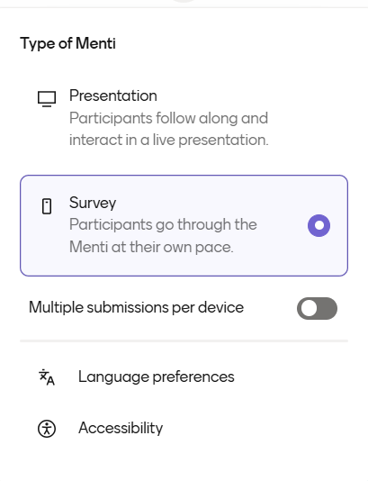
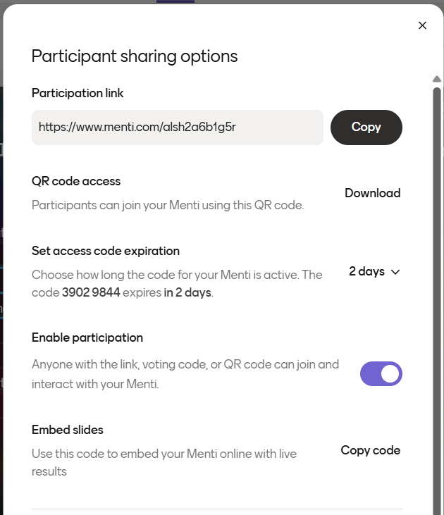

# Designing a HSMA Day

## How an HSMA Day Runs


HSMA days run from 09:30 - 16:30, with a 1 hour break for lunch between 12:30 and - 13:30.

You therefore effectively have two main 3 hour blocks of teaching to fill with a mixture of lectures, group exercises, and discussions.


::: {.callout-tip}

We'd generally set an upper limit of 1 hour on any single lecture section.

30 - 45 minutes is a better target where possible.

:::


::: {.callout-tip}

Don't forget to leave time for breaks! Across a 3 hour morning section, I like to give at least one 10 minute break, and a 5 minute 'comfort break' as well if the sessions allow. This is a minimum - give 20 minutes total if you have breathing room.

:::

### Schedules

We always provide a schedule to students ahead of time.


::: {.callout-note collapse="true"}
#### Click here to view some sample itineraries

This is an example of one of Dan's sessions.

```{=html}
<iframe width='780' height='500' src='https://docs.google.com/spreadsheets/d/1x4JcT5PvvqN5CL3o5KS0TkpVoN9lmmaXyjaJ_uU0Tu4/edit?usp=sharing' title='1B schedule'></iframe>
```

This is an example of one of Sammi's sessions.

```{=html}
<iframe width='780' height='500' src='https://docs.google.com/spreadsheets/d/13bB79qiSQ3uxhnUUKhaDOs7q2uw-RoSwXjuKGyqu_T8/edit?usp=sharing' title='2F schedule'></iframe>
```

:::


## Group work in HSMA

HSMAs are placed into 'peer support groups' (PSGs) when they start on the programme and, for the most part, will stay with the same PSG throughout.

In HSMA 7, we are giving students more control over how they prefer to work.

| | Option A | Option B |
|---|---|---|
| **Group make-up** | A more varied level of prior knowledge | A more similar level of prior knowledge |
| **Working style** | Primarily individually, each on their own copy of an exercise, but working as a group to make sure everyone is progressing and to answer questions | Primarily collaboratively, all working on a single copy of the exercise together |

Together, these give four possible combinations:

| | **Varied prior knowledge** | **Similar prior knowledge** |
|---|---|---|
| **Individual working** | Mixed-experience group, each working on their own copy | Similar-experience group, each working on their own copy |
| **Collaborative working** | Mixed-experience group, working together on a single copy | Similar-experience group, working together on a single copy |


::: {.callout-note}
### Reminder - Prior level of student knowledge

HSMA is aimed at people with a wide range of backgrounds, from those with no prior computer programming experience all the way up to experienced python programmers with significant prior knowledge in areas such as statistics but who have perhaps not dabbled in operational research or machine learning previously.

Therefore, exercises need to provide something for all of those people! This can be challenging but is achievable, and later parts of this section expand on some ways you can support this.

Read more about the pacing and prior level of knowledge in [this section](pacing_and_prior_knowledge.qmd).

:::


## Types of Group Exercises


::: {.callout-tip}

It's generally not worth putting students into their groups for less than about 30 minutes, due to the overhead associated with getting them into their breakout rooms.

:::


### Code Exercises

A large number of exercises in HSMA will involve getting students to work on some code.

#### Working in Python Compiler

Early sessions make use of https://pythoncompiler.io/

However, once students have been introduced to Positron and environment management with Mamba in session 1D, we would expect them to no longer be using python compiler for exercises.

::: {.callout-note}

See the [HSMA tech stack](hsma_tech_stack.qmd) page for more information about how students are expected to work on sessions.

:::


#### Working from a given .py file

In some exercises, students will be provided with a .py file. This may

Here are some examples:

- Exercise 1 in HSMA 6 5C (sentiment analysis)
    - [Slides: exercise 1, slide 30](https://docs.google.com/presentation/d/1k2gQkA6Qa0TKm47Hh6tM7heTpYh6w2wF27ImQC_BeXk/edit?usp=sharing)
    - [Code](https://github.com/hsma-programme/h6_5c_sentiment_analysis/blob/main/5c_sentiment_analysis/sa_1.py)


#### Working from a given notebook

You may wish to give students a notebook they can work from.

There are lots of examples of this in HSMA 6 module 3:

- Exercise 1 in HSMA 6 3C:
    - [Slides: exercise 1, slide 28](https://docs.google.com/presentation/d/1Xj9jYaJ_FH7ko84DGJ2M1l4DWfJ-W5wmY906UkUEgRg/edit?usp=sharing)
    - [Notebook](https://github.com/hsma-programme/h6_3c_interactive_plots_travel/blob/main/h6_3c_interactive_plots_travel/exercises/HSMA%203C%20Exercise%201%20-%20Interactive%20Plots.ipynb)


#### Starting from scratch

Students may also be given instructions where they are expected to write a .py file, .qmd file, notebook, streamlit app, or other kind of artefact from scratch. Alternatively, in sessions relating to tools like Git, they may not be writing code as an artefact, but it's along the same lines.


Here are some examples:

- Writing a py file from scratch in HSMA 6 2C SimPy Part 2
    - [Slides: exercise 1, slide 25](https://docs.google.com/presentation/d/1y7S7bjJtdLQCquzzZ2vjYzRx9-RwXE-SWgWf88fLc4o/edit?usp=sharing)
- Writing a .qmd file using a given .py file in HSMA 6 8A Quarto
    - [Slides: exercise 1, slide 57](https://docs.google.com/presentation/d/1XYMK5b4dNaHfVesHO2EvRn1j2lFgQULadbRUU5FCkDg/edit?usp=sharing)

### Design Exercises

In some cases, there may be design-based exercises where students plan something like a DES model by hand, with no code written.

Here are some examples:

- Design a Discrete Event Simulation for a system of your choosing
    - [Slides: exercise 1, slide 19](https://docs.google.com/presentation/d/1HO0wXTocHRZgeuLadkGvqf5yC8BEmQzTcgo8QHOd0yY/edit?usp=sharing)
- Design a ML model by hand to classify Dan's desert island DVDs
    - [Slides: exercise 2, slide 33](https://docs.google.com/presentation/d/1EcO71B5kEvaSkvKQeGnuO2g4Ss4RKhrphR3gE8vv-Gk/edit?usp=sharing)

### Discussion Exercises

You may wish to get students to discuss a topic and report their findings back to the wider group.

You should consider ways to make the discussion inclusive (e.g. encouraging the use of zoom whiteboards or similar features so people can contribute points as post-it notes).

### Interactive Tool Exercises

We have several interactive tools available on HSMA that can form part of teaching.


::: {.callout-note}
Check whether each is hosted on stlite (in which case it will have a .hsma or .github.io link) or on streamlit community cloud (in which case there will be streamlit.app in the URL).

stlite apps can be used by an unlimited number of users simultaneously.

Other apps need to be used cautiously as they are likely to exceed limits, so you may need to get students running them locally (and they don't learn streamit until sessions 2h and 2g).
:::


**DES**

- [The full DES playground](https://github.com/hsma-programme/Teaching_DES_Concepts_Streamlit)
- [The mini DES playground](https://github.com/hsma-programme/des_playground_mini)
- [Interactive vidigi exercise and playground](https://github.com/hsma-programme/nhs_oa_vidigi_streamlit)

**Geographic**

- [The full geographic decision-making roleplay](https://github.com/hsma-programme/geographic_or_ds_playground)
- [The mini geographic playground](https://github.com/hsma-programme/geographic_playground_mini)

**Machine learning**

- [The 'commissioner' ML readmission model sign-off roleplay](https://github.com/hsma-programme/lambda_ml_streamlit_exercise)
- [The mini ML playground](https://github.com/Bergam0t/ml_playground_mini)
- [The reinforcement learning game](https://github.com/Bergam0t/ReinforcementLearningGame)

You might also consider using other online sites that support a particular point
- e.g. https://thetruesize.com/ as part of a larger exercise on map projections


## Other Types of Exercises

### Short Interactive Solo Exercises

To keep participants engaged, it can be helpful to scatter small interactive exercises into longer lecture sections.

#### Zoom Poll

We can't easily use Zoom's built-in polls due to Zoom limitations: only the host (Dan) can create them in advance and launch them, and transfer of host or co-host responsibilities within the Zoom app doesn't help.

Therefore, it's recommended to use Menti instead.

[Zoom poll documentation](https://support.zoom.com/hc/en/article?id=zm_kb&sysparm_article=KB0066150)


#### Menti

Menti supports small interactive polls. Through the university of Exeter, we have access to a paid Menti account if you sign in with SSO.

There are two key types of Menti polls:

- survey (self-paced)
- presentation (presenter controls progression through questions)



In HSMA, we tend to use 'survey', though 'presentation' may be appropriate in certain circumstances (but is generally a bit more challenging for the trainer to juggle alongside presenting slides).


##### Setting up Menti Polls

We have a built-in HSMA theme we can provide access to (but we'll need your email address to do that).


You will need to provide editor access to any Menti polls to both Dan (d.chalk@exeter.ac.uk) and Sammi (s.j.rosser@exeter.ac.uk) using the 'invite user to collaborate' button.

For all questions, consider whether you want to hide participant responses until the trainer clicks, so that users aren't influenced by other participant's answers.

You can do this per question by choosing the edit button while the question is selected.


##### Sharing Menti Polls with Participants

::: {.value-box fragment="fade-in" icon="fa-solid fa-triangle-exclamation" icon-position="left" align="center" color="bg-amber"}
Note that Menti join codes expire after only a few days (currently the maximum that can be set is 14 days), but QR codes and the menti URL for the poll do not expire, so can be set up well in advance.
:::

Therefore, it's best to provide a slide with the QR code and the url (but not the access code). The trainer can then also paste the URL into the session on the day.


##### Sharing Menti Poll Results

**Quarto**

::: {.value-box fragment="fade-in" icon="fa-solid fa-lightbulb" icon-position="left" align="center" color="bg-green"}
If you are using Quarto slides, you can integrate the results page directly into the slides, so you can see the responses without having to navigate elsewhere
:::

To embed into your Quarto slides, get the 'embed slides' link from the participant sharing options (accessed by clicking 'share').



This will give you a block like the below that you can copy in to your Quarto slides.

```{=html}
<div style='position: relative; padding-bottom: 56.25%; padding-top: 35px; height: 0; overflow: hidden;'><iframe sandbox='allow-popups allow-scripts allow-same-origin allow-presentation' allowfullscreen='true' allowtransparency='true' frameborder='0' height='315' src='https://www.mentimeter.com/app/presentation/alhnxerb89pu6fsoydbnf77kstkx2i31/embed' style='position: absolute; top: 0; left: 0; width: 100%; height: 100%;' width='420'></iframe></div>
```


**Google Slides**

If using google slides, just copy the long mentimeter link into the slides. In the participant sharing options, make sure the Access Level is set to 'Limited'.


