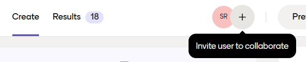
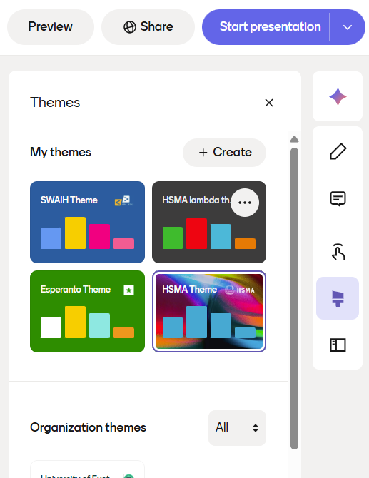
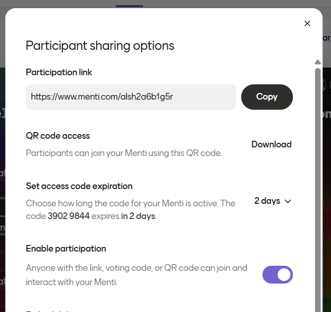
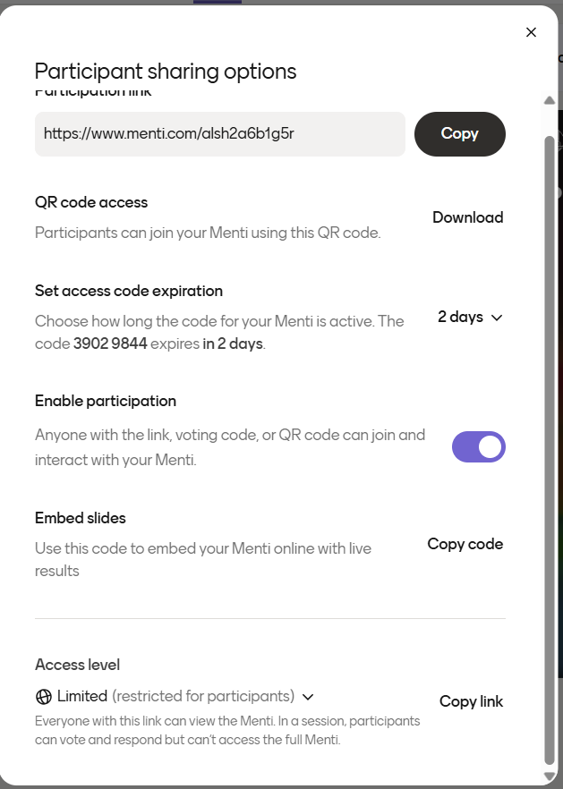

# How an HSMA Day Runs


HSMA days run from 09:30 - 16:30, with a 1 hour break for lunch between 12:30 and - 13:30.

You therefore effectively have two main 3 hour blocks of teaching to fill with a mixture of lectures, group exercises, and discussions.


## Prior level of student knowledge

HSMA is aimed at people with a wide range of backgrounds, from those with no prior computer programming experience all the way up to experienced python programmers with significant prior knowledge in areas such as statistics but who have perhaps not dabbled in operational research or machine learning previously.

Therefore, exercises need to provide something for all of those people! This can be challenging but is achievable, and later parts of this section expand on some ways you can support this.


## Group work in HSMA

HSMAs are placed into 'peer support groups' (PSGs) when they start on the programme and, for the most part, will stay with the same PSG throughout.

In HSMA 7, we are giving students more control over how they prefer to work.

| | Option A | Option B |
|---|---|---|
| **Group make-up** | A more varied level of prior knowledge | A more similar level of prior knowledge |
| **Working style** | Primarily individually, each on their own copy of an exercise, but working as a group to make sure everyone is progressing and to answer questions | Primarily collaboratively, all working on a single copy of the exercise together |

Together, these give four possible combinations:

| | **Varied prior knowledge** | **Similar prior knowledge** |
|---|---|---|
| **Individual working** | Mixed-experience group, each working on their own copy | Similar-experience group, each working on their own copy |
| **Collaborative working** | Mixed-experience group, working together on a single copy | Similar-experience group, working together on a single copy |


## Types of Group Exercises

It's generaally not worth putting students into their groups for less than about 30 minutes, due to the overhead associated with getting them into their breakout rooms.


### Code Exercises

Many


#### Working in Code Compiler


#### Working from a given .py file


#### Working from a given notebook


#### Starting from scratch


### Design Exercises


### Discussion Exercises


### Interactive Tool Exercises


## Other Types of Exercises

### Short Interactive Solo Exercises

To keep participants engaged, it can be helpful to scatter small interactive exercises into longer lecture sections.

#### Zoom Poll

We can't easily use Zoom's built-in polls due to Zoom limitations: only the host (Dan) can create them in advance and launch them, and transfer of host or co-host responsibilities within the Zoom app doesn't help.

Therefore, it's recommended to use Menti instead.

[Zoom poll documentation](https://support.zoom.com/hc/en/article?id=zm_kb&sysparm_article=KB0066150)


#### Menti

Menti supports small interactive polls. Through the university of Exeter, we have access to a paid Menti account if you sign in with SSO.

There are two key types of Menti polls:

- survey (self-paced)
- presentation (presenter controls progression through questions)


In HSMA, we tend to use 'survey', though 'presentation' may be appropriate in certain circumstances (but is generally a bit more challenging for the trainer to juggle alongside presenting slides).



##### Setting up Menti Polls

We have a built-in HSMA theme we can provide access to (but we'll need your email address to do that).



You will need to provide editor access to any Menti polls to both Dan (d.chalk@exeter.ac.uk) and Sammi (s.j.rosser@exeter.ac.uk) using the 'invite user to collaborate' button.

For all questions, consider whether you want to hide participant responses until the trainer clicks, so that users aren't influenced by other participant's answers.

You can do this per question by choosing the edit button while the question is selected.


##### Sharing Menti Polls with Participants

::: {.value-box fragment="fade-in" icon="fa-solid fa-triangle-exclamation" icon-position="left" align="center" color="bg-amber"}
Note that Menti join codes expire after only a few days (currently the maximum that can be set is 14 days), but QR codes and the menti URL for the poll do not expire, so can be set up well in advance.
:::

Therefore, it's best to provide a slide with the QR code and the url (but not the access code). The trainer can then also paste the URL into the session on the day.




##### Sharing Menti Poll Results

**Quarto**

::: {.value-box fragment="fade-in" icon="fa-solid fa-lightbulb" icon-position="left" align="center" color="bg-green"}
If you are using Quarto slides, you can integrate the results page directly into the slides, so you can see the responses without having to navigate elsewhere
:::

To embed into your Quarto slides, get the 'embed slides' link from the participant sharing options (accessed by clicking 'share').


This will give you a block like the below that you can copy in to your Quarto slides.

```{=html}
<div style='position: relative; padding-bottom: 56.25%; padding-top: 35px; height: 0; overflow: hidden;'><iframe sandbox='allow-popups allow-scripts allow-same-origin allow-presentation' allowfullscreen='true' allowtransparency='true' frameborder='0' height='315' src='https://www.mentimeter.com/app/presentation/alhnxerb89pu6fsoydbnf77kstkx2i31/embed' style='position: absolute; top: 0; left: 0; width: 100%; height: 100%;' width='420'></iframe></div>
```


**Google Slides**

If using google slides, just copy the long mentimeter link into the slides. In the participant sharing options, make sure the Access Level is set to 'Limited'.


